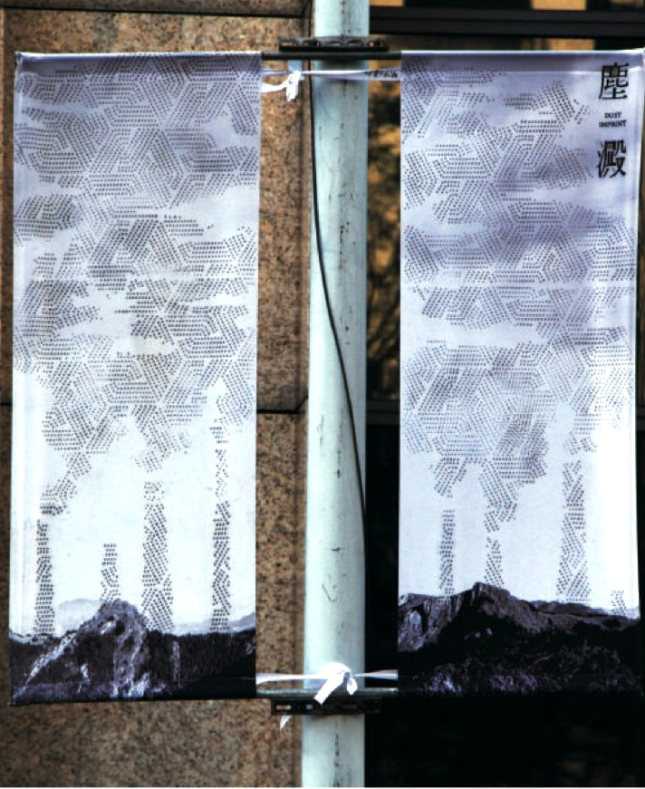

---
title:
  zh: 塵澱畢業製作
  en: DustImprint (graduation project)
summary:
  zh: 讓灰塵附著在路燈旗上，圖樣隨灰塵累積而改變，讓每天經過的人看見空氣污染。
  en: Street-lamp banners that collect dust, so the picture changes as dust builds up and passers-by can see air pollution.
category: design
start: 2016
end: 2017
role:
  zh: 組長
  en: Team leader
metrics:
  - label:
      zh: 實際掛設的路燈旗
      en: Banner sets hung on a real street
    value:
      zh: 18 組
      en: "18"
    note:
      zh: 2017 年 4 月，板橋區漢生東路
      en: April 2017, Hansheng East Road, Banqiao
  - label:
      zh: 作品系列
      en: Series
    value:
      zh: 3 個
      en: "3"
    note:
      zh: 山水、植物、人物
      en: Landscape, plants, people
  - label:
      zh: 製作時間
      en: Duration
    value:
      zh: 近一年
      en: Nearly a year
status: archived
cover: ../../assets/projects/chen-dian/banner-title.jpg
coverAlt:
  zh: 印著塵澱標題的路燈旗近照
  en: Close-up of a street-lamp banner printed with the project title
---

# zh
## 專案簡介

擔任畢業製作塵澱的組長，與組員花近一年共同完成以空氣污染為主題的作品。路燈旗上的黏膠會讓灰塵附著，圖樣隨灰塵累積而改變，讓每天經過的人看見空氣污染。

作品分成山水（車道、城市、工廠）、植物（肺、腦、心血管）、人物（年長者、過敏兒、動物）三個系列，於 2017 年 4 月中旬在板橋區漢生東路實際掛設 18 組路燈旗，並以縮時影片記錄，入圍金點設計獎。

# en
## Overview

Served as team leader on a graduation project visualising air pollution, working with the team over nearly a year. Adhesive on street-lamp banners collects dust, changing the pictures as it builds up and making air pollution visible to passers-by.

The three series cover landscapes (roads, cities, factories), plants (lungs, brain, heart and blood vessels) and people (older people, children with allergies, animals). In mid-April 2017, 18 sets were installed on Hansheng East Road in Banqiao and recorded in a time-lapse film. The project was a Golden Pin Design Award finalist.

