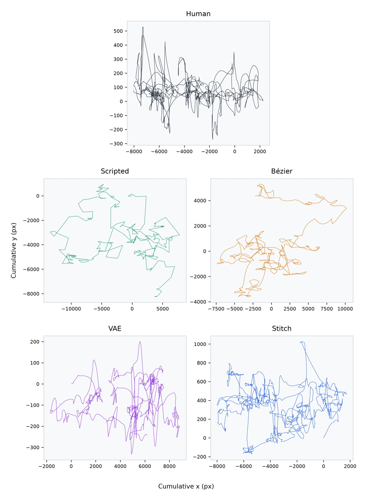

---
title:
  zh: 跨遊戲零樣本機器人偵測（碩士論文）
  en: Cross-Game Transferability of Mouse-Dynamics Bot Detection (MSc dissertation)
summary:
  zh: 研究滑鼠軌跡偵測模型能否跨遊戲辨識機器人，分析尺度不變特徵與判斷門檻校準的影響。
  en: Research into cross-game bot detection from mouse trajectories, evaluating scale-invariant features and threshold calibration.
category: data
start: 2026
featured: true
order: 2
role:
  zh: 碩士論文作者（英國伯明罕大學）
  en: Dissertation author (University of Birmingham)
metrics:
  - label:
      zh: 純合成攻擊的偵測率
      en: Detection of from-scratch synthetic attacks
    value: 100%
    note:
      zh: 5% 誤報率下，三種攻擊、三個轉移方向
      en: At 5% false-positive rate, 3 attacks across 3 transfer directions
  - label:
      zh: ROC-AUC
      en: AUC
    value: ≥ 0.958
    note:
      zh: 最終的 10 個尺度不變特徵
      en: Final set of 10 scale-invariant features
  - label:
      zh: 公開遊戲資料集
      en: Public gameplay datasets
    value:
      zh: 3 個
      en: "3"
    note:
      zh: 兩款 FPS、一款 MOBA
      en: 2 FPS and 1 MOBA
links:
  github: https://github.com/yc-rainyu/cross-game-bot-detection
status: research
cover: ../../assets/projects/cross-game-bot-detection/mouse-paths-cover.jpg
coverAlt:
  zh: 一位真人玩家與四種合成軌跡產生器在同一場三分鐘遊戲中的滑鼠累積軌跡
  en: Cumulative mouse paths over one three-minute session for a human player and the four synthetic generators
---

# zh
## 專案簡介

英國伯明罕大學電腦科學碩士論文（2026），研究只用一款遊戲資料訓練的行為式反作弊偵測器，能否在不重新訓練的情況下偵測另一款遊戲中的機器人，處理新遊戲缺少作弊樣本的冷啟動問題。相關論文已投稿 ACM SAC 2027。

- 使用 Python 整理三個公開遊戲資料集（兩款 FPS、一款 MOBA，共 289 位玩家），統一軌跡格式、座標與時間單位。處理步驟包含將絕對游標座標轉成位移，以及將視線向量轉成偏航角與俯仰角（yaw／pitch）的變化。
- 實作規則式、貝茲曲線、VAE 與真人片段拼接四種合成滑鼠軌跡產生器，用來訓練隨機森林偵測器，並讓訓練與評估資料中的玩家互不重疊，避免資料洩漏。
- 比較三組特徵集，僅用未標記的人類資料校準判斷門檻。最終的 10 個尺度不變特徵在三個轉移方向上，對三種純合成攻擊皆達到 100% 偵測率（5% 誤報率，ROC-AUC ≥ 0.958）。真人片段拼接的軌跡仍能跨遊戲躲過運動學特徵偵測，因此提出分層防禦的必要性。

研究將跨遊戲偵測失敗的情況分成分數分布改變、判斷方向反轉與特徵訊號消失，分別檢查判斷門檻與特徵的影響。例如在 Red Eclipse → LoL 的貝茲曲線攻擊中，使用原始特徵時的 AUC 為 0.242，改用最終尺度不變特徵後達到 1.000。分類器維持使用隨機森林，主要比較特徵設計對轉移能力的影響。

三個轉移方向為 Red Eclipse → CS:GO、CS:GO → Red Eclipse 與 Red Eclipse → LoL。零樣本轉移不重新訓練目標遊戲的偵測器，但仍使用目標遊戲的人類分數校準門檻，不需要目標遊戲的機器人樣本。研究也保留真人片段拼接能躲過偵測的結果，說明運動學特徵偵測的限制。

# en
## Overview

This MSc Computer Science dissertation at the University of Birmingham (2026) investigates whether a behaviour-based anti-cheat detector trained on one game can detect bots in another without retraining, addressing the cold start when new games have no cheat samples. A paper has been submitted to ACM SAC 2027.

- Built a Python pipeline that unifies units and logging formats across three public gameplay datasets (two FPS and one MOBA, 289 players). This includes differencing absolute cursor coordinates and converting view-direction vectors into yaw and pitch changes, accounting for different coordinate and time units.
- Implemented four synthetic mouse-trajectory generators using rules, Bézier curves, a VAE and stitched human segments. Trained a Random Forest detector and evaluated it on player-disjoint splits to avoid data leakage.
- Compared three feature sets with thresholds calibrated on unlabelled human data alone. The final 10 scale-invariant features achieved 100% detection of three from-scratch synthetic attacks across three transfer directions (5% false-positive rate, ROC-AUC ≥ 0.958). Human-replay trajectories evaded kinematic detection across games, motivating a layered defence.

The study separates cross-game failures into score-distribution shifts, ranking inversion and loss of discriminative signal, examining the effects of thresholds and features. For example, Bézier attacks under Red Eclipse → LoL had an AUC of 0.242 with raw features and 1.000 with the final scale-invariant set. The classifier remained a Random Forest; the comparison focused on how feature design affects transfer.

The three transfer directions were Red Eclipse → CS:GO, CS:GO → Red Eclipse and Red Eclipse → LoL. Zero-shot transfer does not retrain the target-game detector, but still uses target-game human scores to calibrate its threshold, without target-game bot samples. Negative results for stitched human trajectories are retained as a boundary of kinematic detection.

