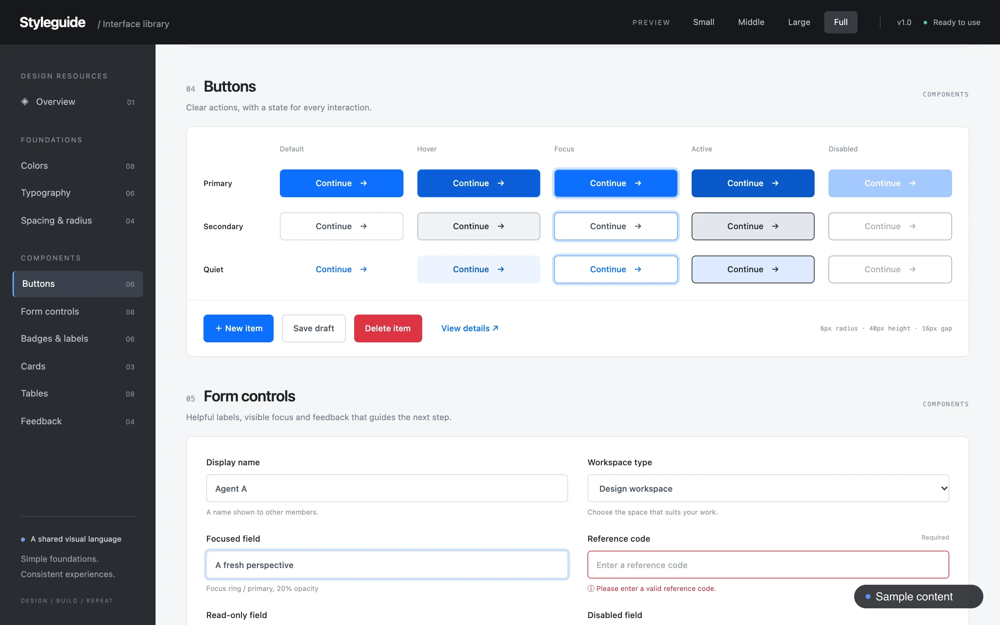
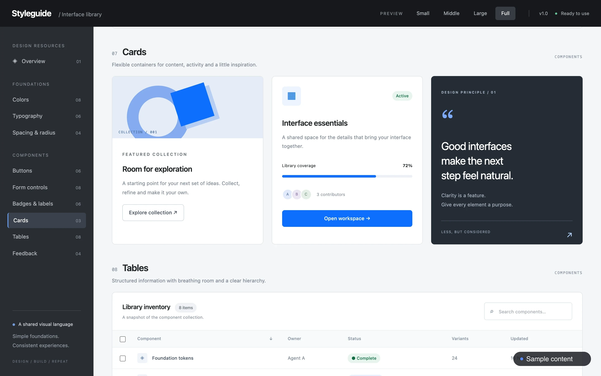

---
title:
  zh: 設計師專用 UI 元件庫
  en: Designer-facing UI Component Library
summary:
  zh: 開發只需 HTML 與 CSS 就能使用的元件庫，將設計稿交付時的來回確認從 4 至 5 輪降到 1 至 2 輪。
  en: A component library designers can use with HTML and CSS alone, which cut design hand-offs from 4–5 review rounds to 1–2.
category: frontend
start: 2023
role:
  zh: 前端工程師，主動發起並開發（日新軟體）
  en: Front-end Engineer, initiated and developed the library (Neutec Ltd.)
metrics:
  - label:
      zh: 設計稿交付的來回確認
      en: Review rounds per hand-off
    value:
      zh: 4–5 輪 → 1–2 輪
      en: 4–5 → 1–2
  - label:
      zh: 使用成員
      en: Used by
    value:
      zh: 4 位設計師、3 位工程師
      en: 4 designers, 3 engineers
  - label:
      zh: 採用產品
      en: Products
    value:
      zh: 2–3 項
      en: 2–3
status: internal
cover: ../../assets/projects/designer-ui-library/foundations.webp
coverAlt:
  zh: 樣式指南範本中的色票與字級，使用示範內容
  en: Colour palette and type scale in the style guide template, filled with sample content
---

# zh
## 專案簡介

設計稿交付開發後，經常需要來回 4 至 5 輪確認，因此主動開發一套只需 HTML 與 CSS 就能使用的 UI 元件庫，讓設計師也能直接操作。

元件庫用設定檔管理分類與元件，再由 JavaScript 讀取 HTML 範本與專案 CSS，自動產生導覽目錄、元件預覽與程式碼範例，並支援一鍵複製 HTML。4 位設計師與 3 位工程師在 2 至 3 項產品中使用後，交付時的來回確認降至 1 至 2 輪，後續調整也直接透過元件庫溝通。

畫面為填入示範內容的樣式指南範本。

# en
## Overview

Initiated and developed a UI component library to reduce the 4 to 5 review rounds needed for design hand-offs. Designers could use the library with HTML and CSS alone. A configuration file organises categories and components; JavaScript loads HTML templates and project CSS to generate navigation, component previews and code examples, with one-click HTML copying.

The library was used by 4 designers and 3 engineers across 2 to 3 products. Hand-offs fell to 1 to 2 rounds, and later adjustments were discussed directly through the library.

The visuals show the style guide template filled with sample content.
