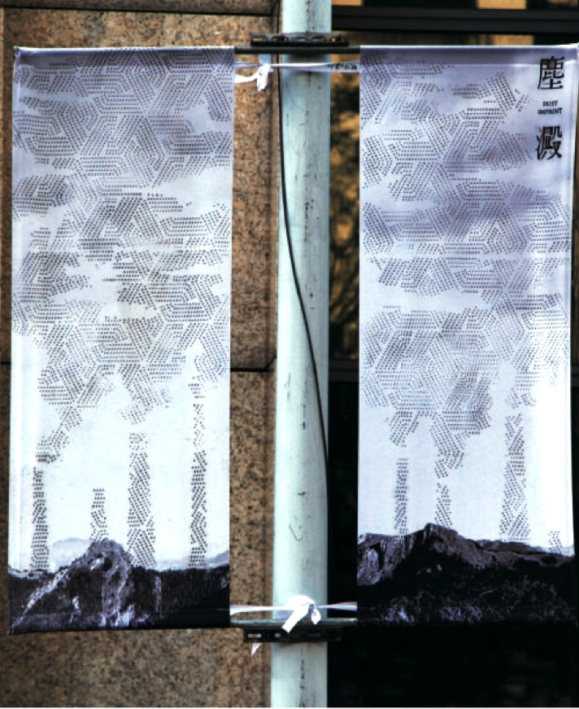

## Overview

Served as team leader on a graduation project visualising air pollution, working with the team over nearly a year. Adhesive on street-lamp banners collects dust, changing the pictures as it builds up and making air pollution visible to passers-by.

The three series cover landscapes (roads, cities, factories), plants (lungs, brain, heart and blood vessels) and people (older people, children with allergies, animals). In mid-April 2017, 18 sets were installed on Hansheng East Road in Banqiao and recorded in a time-lapse film. The project was a Golden Pin Design Award finalist.

