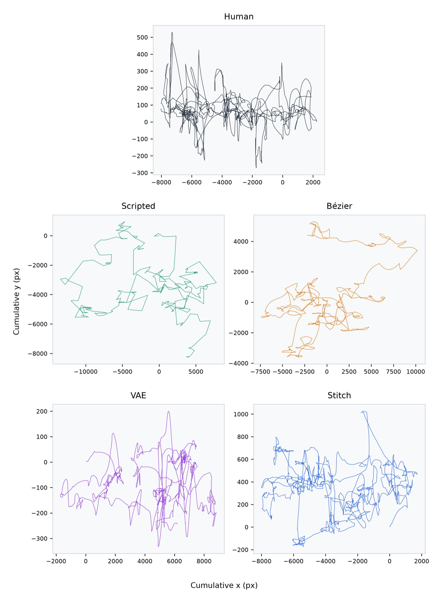

## Overview

This MSc Computer Science dissertation at the University of Birmingham (2026) investigates whether a behaviour-based anti-cheat detector trained on one game can detect bots in another without retraining, addressing the cold start when new games have no cheat samples. A paper has been submitted to ACM SAC 2027.

- Built a Python pipeline that unifies units and logging formats across three public gameplay datasets (two FPS and one MOBA, 289 players). This includes differencing absolute cursor coordinates and converting eye vectors into yaw and pitch changes, accounting for different coordinate and time units.
- Implemented four synthetic mouse-trajectory generators using rules, Bézier curves, a VAE and stitched human segments. Trained a Random Forest detector and evaluated it on player-disjoint splits to avoid data leakage.
- Compared three feature sets with thresholds calibrated on unlabelled human data alone. The final 10 scale-invariant features achieved 100% detection of three from-scratch synthetic attacks across three transfer directions (5% false-positive rate, ROC-AUC ≥ 0.958). Human-replay trajectories evaded kinematic detection across games, motivating a layered defence.
- Used Claude and Cursor for specification-driven development (SDD), agreeing plans and weekly goals. All generated content was checked manually and AI use was documented.

The study separates cross-game failures into score-distribution shifts, ranking inversion and loss of discriminative signal, examining the effects of thresholds and features. For example, Bézier attacks under Red Eclipse → LoL had an AUC of 0.242 with raw features and 1.000 with the final scale-invariant set. The classifier remained a Random Forest; the comparison focused on how feature design affects transfer.

The three transfer directions were Red Eclipse → CS:GO, CS:GO → Red Eclipse and Red Eclipse → LoL. Zero-shot transfer does not retrain the target-game detector, but still uses target-game human scores to calibrate its threshold, without target-game bot samples. Negative results for stitched human trajectories are retained as a boundary of kinematic detection.

