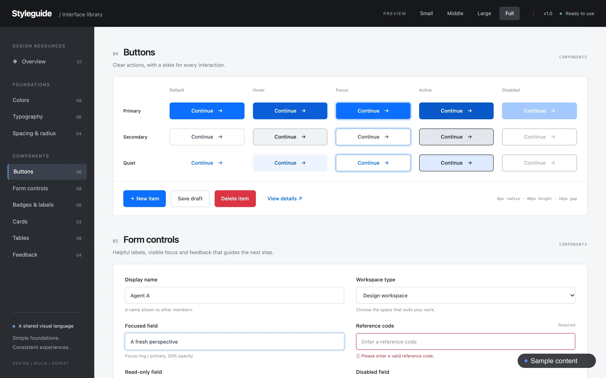
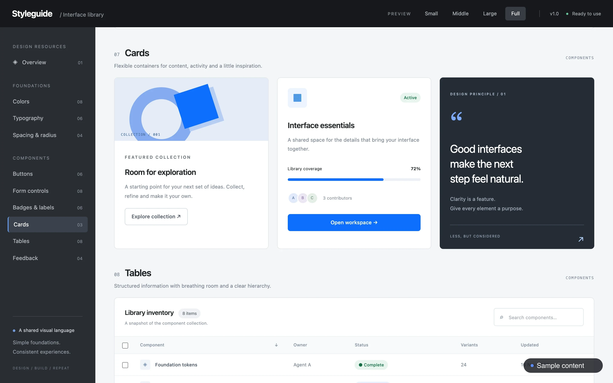

## Overview

Initiated and developed a UI component library to reduce the 4 to 5 review rounds needed for design hand-offs. Designers could use the library with HTML and CSS alone. A configuration file organises categories and components; JavaScript loads HTML templates and project CSS to generate navigation, component previews and code examples, with one-click HTML copying.

The library was used by 4 designers and 3 engineers across 2 to 3 products. Hand-offs fell to 1 to 2 rounds, and later adjustments were discussed directly through the library.

The visuals show the style guide template filled with sample content.
