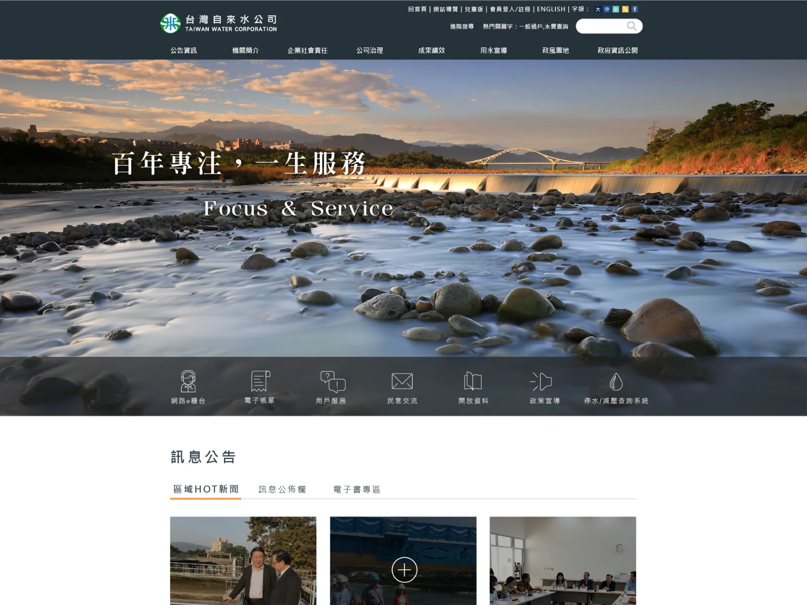
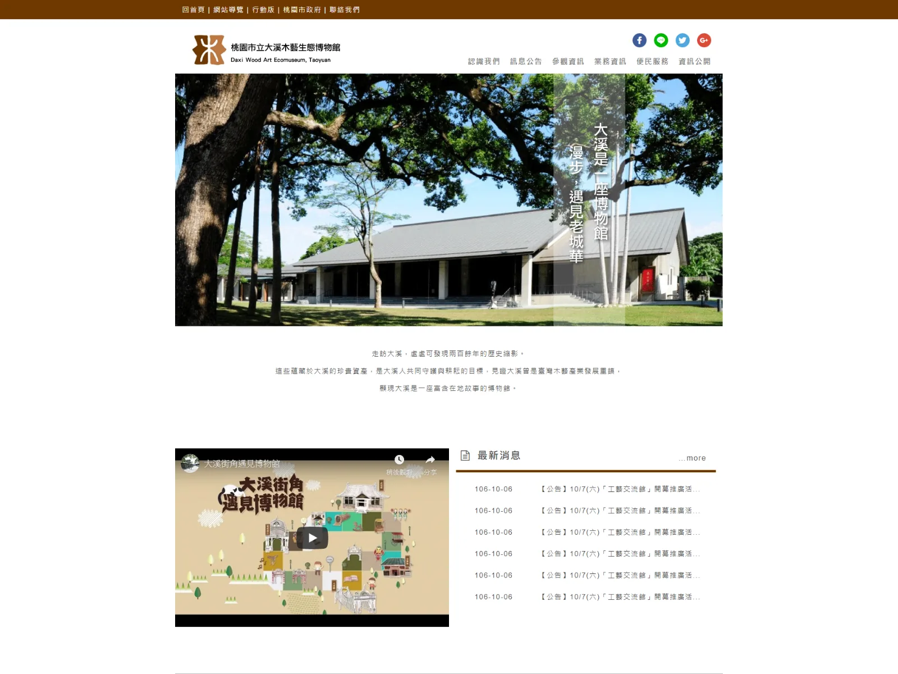
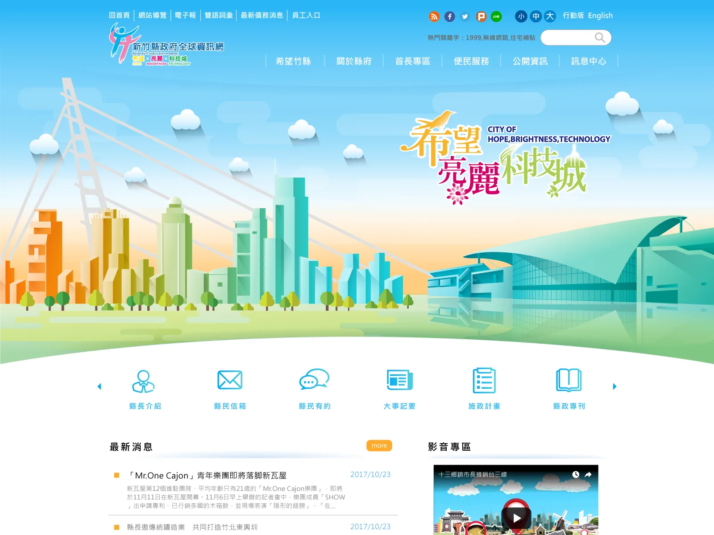
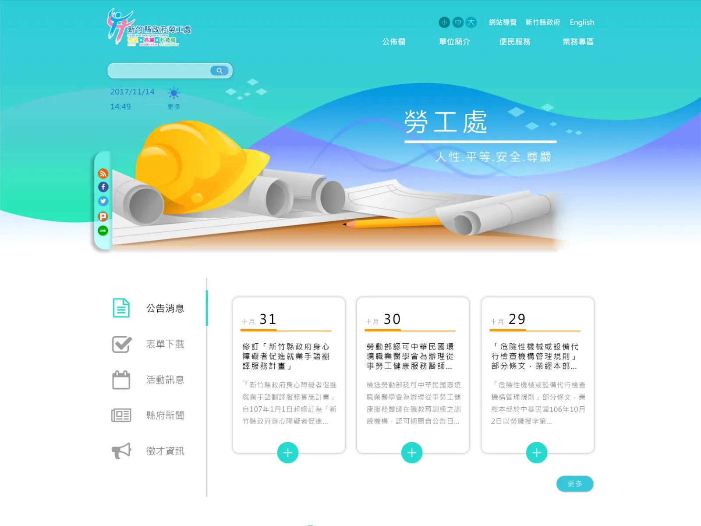
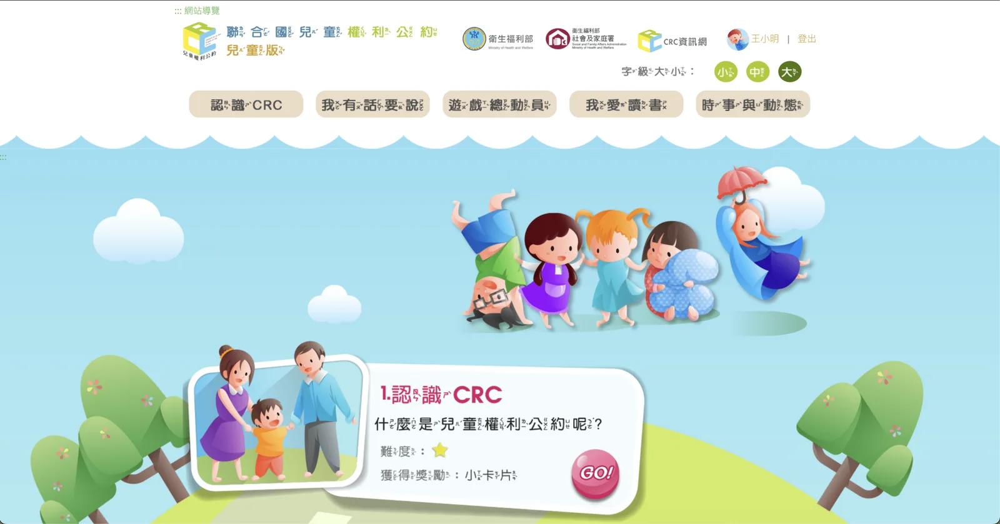

## Overview

Designed and maintained responsive pages for 5+ government websites at Hgiga, covering visual design and HTML/CSS implementation. All sites were built to Taiwan’s government web accessibility standard (WCAG 2.0-based, level AA).

Implemented keyboard navigation, focus behaviour, image alternatives, form labels and text contrast, and corrected issues identified during accessibility testing. Testing was carried out by the company, with government sites also submitted for external assessment and further front-end adjustments.

Projects included the following.

- Taiwan Water Corporation website redesign
- Taiwan Centers for Disease Control website redesign
- Social and Family Affairs Administration’s Convention on the Rights of the Child information system
- Ministry of the Interior form approval system
- Directorate General of Highways staff portal and instant messaging system
- Ministry of Labor shared staff information platform extension
- Daxi Wood Art Ecomuseum cultural resource database
- Hsinchu County Government website
- Hsinchu County Government department websites

Taiwan Water Corporation website

Daxi Wood Art Ecomuseum, Taoyuan

Hsinchu County Government website

Hsinchu County Government department websites

UN Convention on the Rights of the Child, children’s edition

