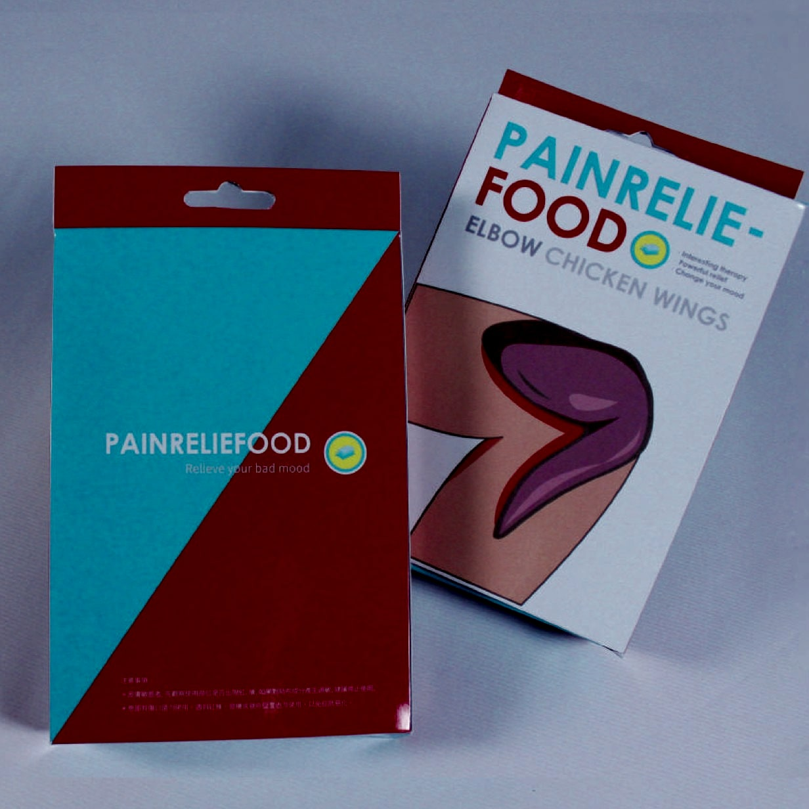

## Overview

Thermochromic pain-relief patches that change colour as they warm with body heat, showing food being cooked. Each design pairs a body part with a food, such as Neck Salmon, Waist Steak and Knee Drumstick.

Made and tested physical samples using powdered thermochromic pigments, adjusting the colours before and after a temperature change.

The project won Gold in the Taiwan round of ASPaC and an Excellence Award at the international final. In January 2017, the Japanese organisers invited me to a two-week packaging design workshop and company visits in Japan, with participants from ten countries.

