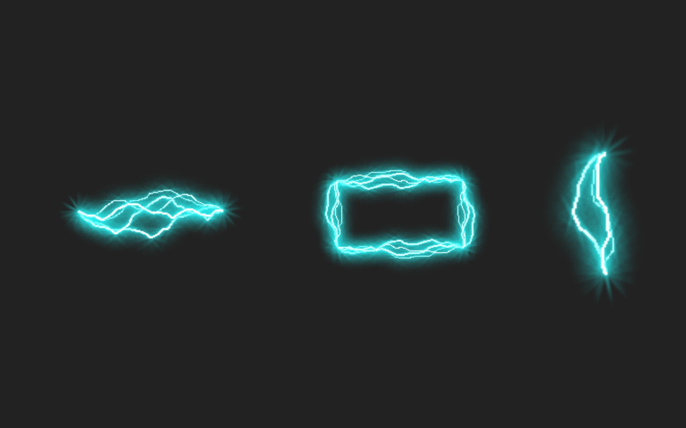

## Overview

Developed a reusable lightning-effect library at Neutec with JavaScript, PixiJS and GSAP, supporting static and animated effects. It was later adopted across the company’s products.

- Designed a path-generation algorithm combining linear interpolation, perpendicular offsets and recursive subdivision to create natural, irregular lightning shapes.
- Built Flashing and Striking animations with GSAP timelines, using glow filters and tapered line widths.
- Exposed a reusable API with controls for paths, angles and roughness, and added a dat.GUI panel to the test page for adjusting parameters in real time.

