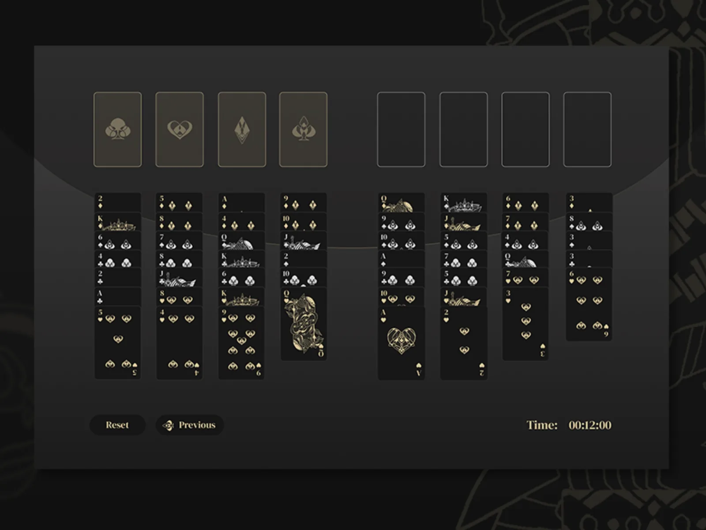
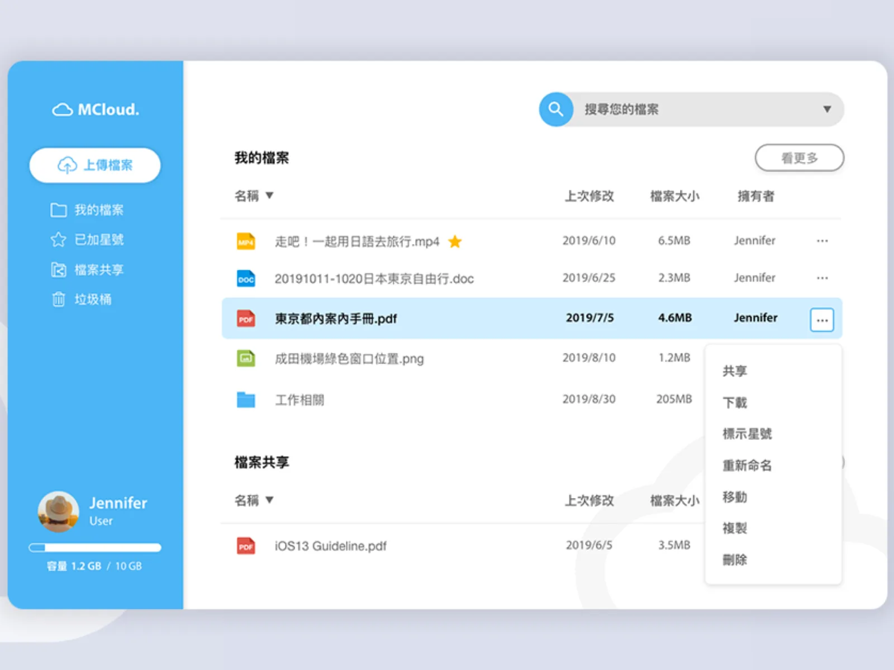
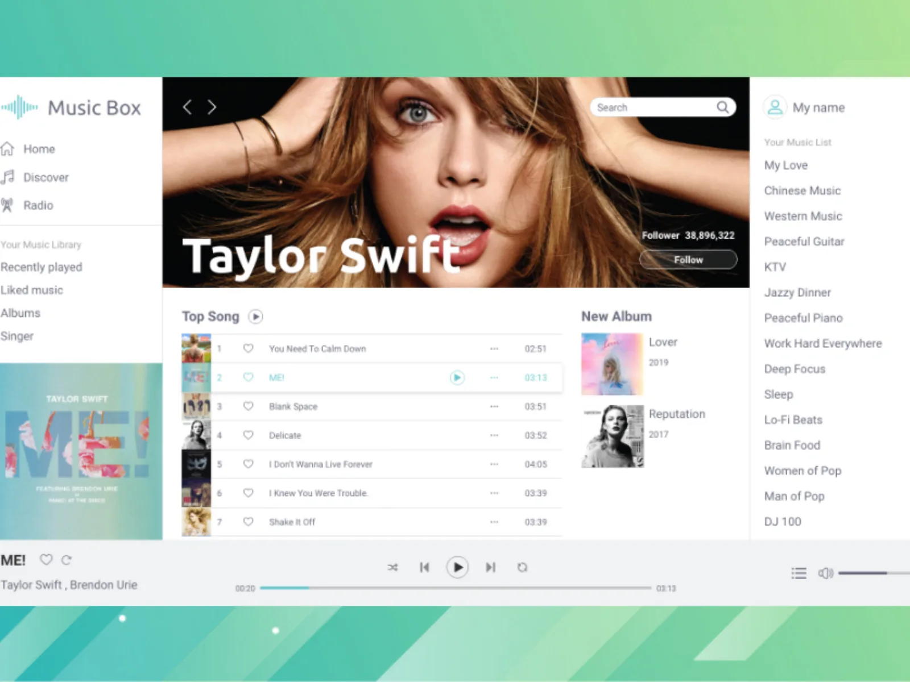

## Overview

Personal projects built during the transition into front-end development in 2019, for The F2E Front-end Challenge and independent study. The challenge ran for nine weeks, with a new theme and a web interface to submit each week.

- [Cloud drive](https://yc-rainyu.github.io/portfolio/storage/) is a week 8 front-end simulation built with React. Users can select local files and create folders; names, sizes and other file metadata are managed as nested JSON in LocalStorage. File contents are not uploaded to a server.
- [Side-scrolling 2D game](https://yc-rainyu.github.io/portfolio/game/) is the week 5 timed challenge, built with Phaser 3, with collisions, physics and random obstacles.
- [FreeCell](https://yc-rainyu.github.io/portfolio/freecell/) is the week 2 project, built with JavaScript and jQuery, with drag and drop, a dealing animation and undo.
- [MP3 player](https://yc-rainyu.github.io/portfolio/media_player/) is the week 3 project, built with jPlayer and jQuery, with playback controls, volume, repeat and shuffle, and a draggable timeline.

FreeCell

Cloud drive

MP3 player

