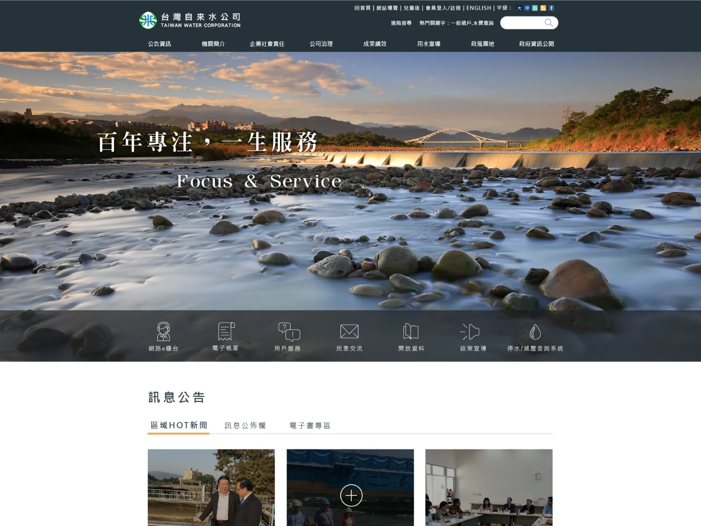
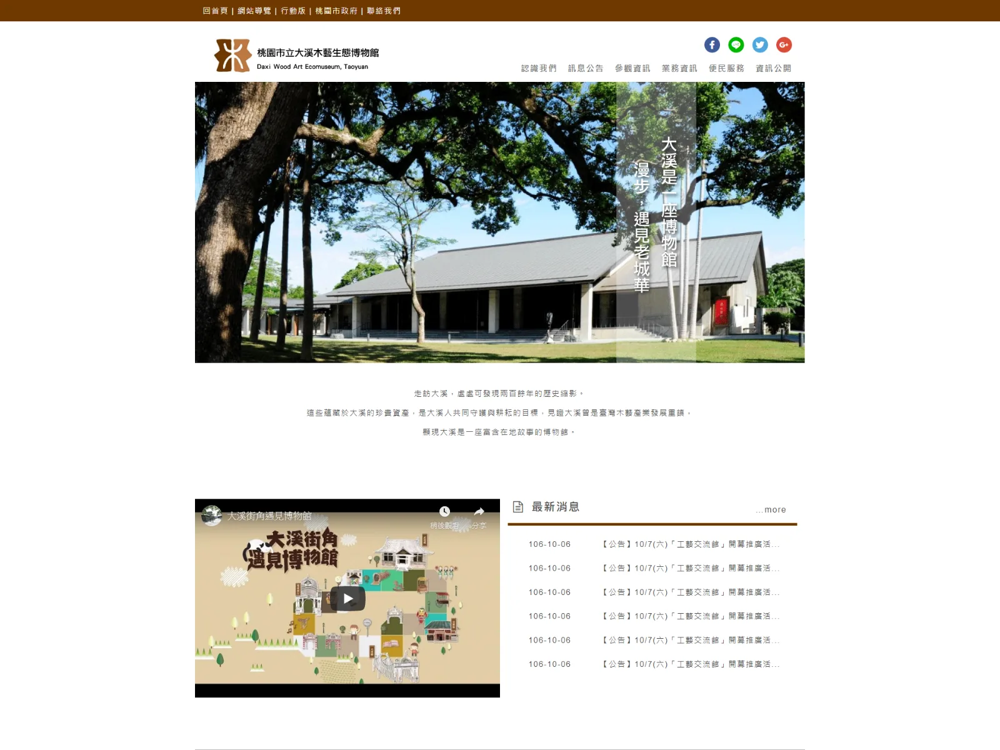
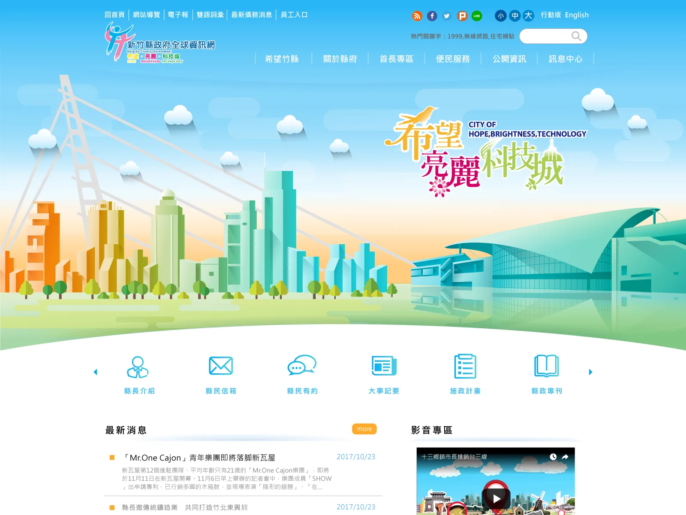
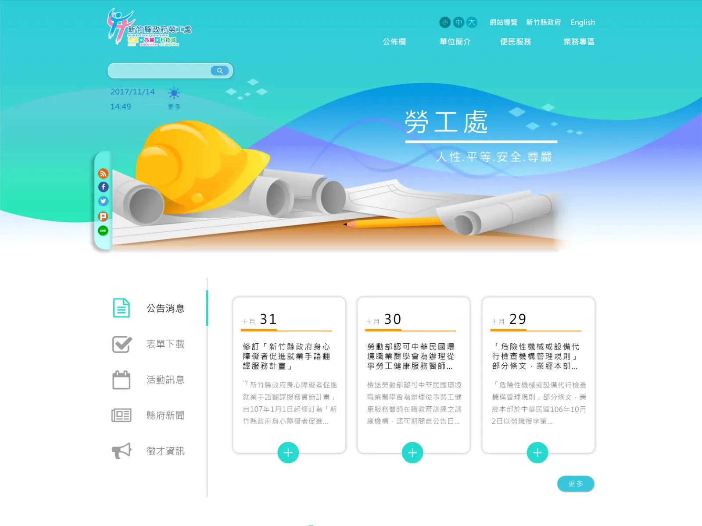
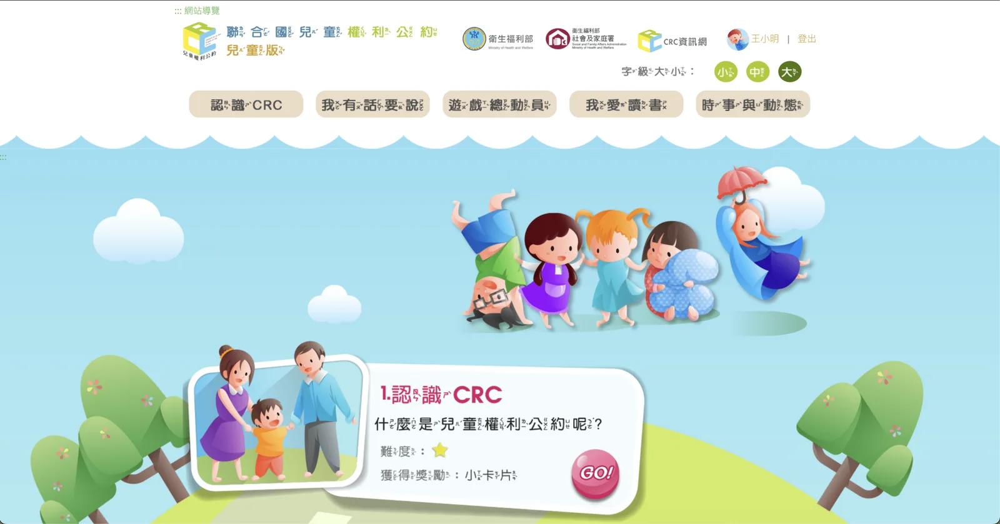

---
title:
  zh: 政府機關網站設計
  en: Government Website Design
summary:
  zh: 設計並維護五個以上政府機關的 RWD 網站，全數符合無障礙 AA 等級。
  en: Designed and maintained responsive websites for 5+ government agencies, all built to level AA of the government accessibility standard.
category: frontend
start: 2017
end: 2019
role:
  zh: 前端設計師，負責視覺設計與切版（桓基科技）
  en: Front-end Designer, visual design and HTML/CSS build (Hgiga Inc.)
metrics:
  - label:
      zh: 政府機關網站
      en: Government websites
    value:
      zh: 5 個以上
      en: 5+
  - label:
      zh: 無障礙規範 2.0
      en: Government web accessibility standard
    value:
      zh: AA 等級
      en: Level AA
    note:
      zh: 全數符合
      en: WCAG 2.0-based, met by all of them
links:
  demo: https://yc-rainyu.github.io/portfolio/water/index.html
cover: ../../assets/projects/government-websites/hsinchu-county.webp
coverAlt:
  zh: 新竹縣政府全球資訊網首頁
  en: Screenshot of the Hsinchu County Government website home page
status: archived
---

# zh
## 專案簡介

在桓基科技擔任前端設計師，負責政府機關網站的視覺設計與切版，設計並維護五個以上政府機關網站的 RWD 前端頁面，全數符合政府網站無障礙規範 2.0 的 AA 等級。

無障礙實作包含鍵盤導覽、焦點狀態、圖片替代文字、表單標籤與文字對比，並依檢測結果修正問題。公司會執行檢測，政府網站也會送交外部檢測，再依結果調整前端。

參與網站如下。

- 台灣自來水公司網站改版
- 衛生福利部疾病管制署全球資訊網改版
- 衛生福利部社會及家庭署兒童權利公約資訊系統
- 內政部表單簽核系統
- 交通部公路總局員工入口網暨即時訊息系統
- 勞動部員工共用資訊系統平台擴充
- 桃園大溪木藝生態博物館大溪學文化資源庫
- 新竹縣政府全球資訊網
- 新竹縣政府各局處網站

[台灣自來水公司全球資訊網](https://yc-rainyu.github.io/portfolio/water/index.html)

[桃園市立大溪木藝生態博物館](https://yc-rainyu.github.io/portfolio/tycg/index.html)

[新竹縣政府全球資訊網](https://yc-rainyu.github.io/portfolio/hchg/index.html)

[新竹縣政府各局處網站](https://yc-rainyu.github.io/portfolio/hchg_2/index.html)

[聯合國兒童權利公約兒童版](https://yc-rainyu.github.io/portfolio/crc-child/index.html)

# en
## Overview

Designed and maintained responsive pages for 5+ government websites at Hgiga, covering visual design and HTML/CSS implementation. All sites were built to Taiwan’s government web accessibility standard (WCAG 2.0-based, level AA).

Implemented keyboard navigation, focus behaviour, image alternatives, form labels and text contrast, and corrected issues identified during accessibility testing. Testing was carried out by the company, with government sites also submitted for external assessment and further front-end adjustments.

Projects included the following.

- Taiwan Water Corporation website redesign
- Taiwan Centers for Disease Control website redesign
- Social and Family Affairs Administration’s Convention on the Rights of the Child information system
- Ministry of the Interior form approval system
- Directorate General of Highways staff portal and instant messaging system
- Ministry of Labor shared staff information platform extension
- Daxi Wood Art Ecomuseum cultural resource database
- Hsinchu County Government website
- Hsinchu County Government department websites

[Taiwan Water Corporation website](https://yc-rainyu.github.io/portfolio/water/index.html)

[Daxi Wood Art Ecomuseum, Taoyuan](https://yc-rainyu.github.io/portfolio/tycg/index.html)

[Hsinchu County Government website](https://yc-rainyu.github.io/portfolio/hchg/index.html)

[Hsinchu County Government department websites](https://yc-rainyu.github.io/portfolio/hchg_2/index.html)

[UN Convention on the Rights of the Child, children’s edition](https://yc-rainyu.github.io/portfolio/crc-child/index.html)

