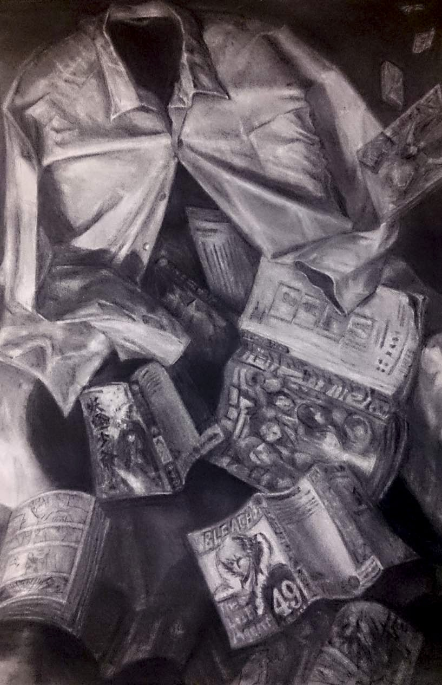
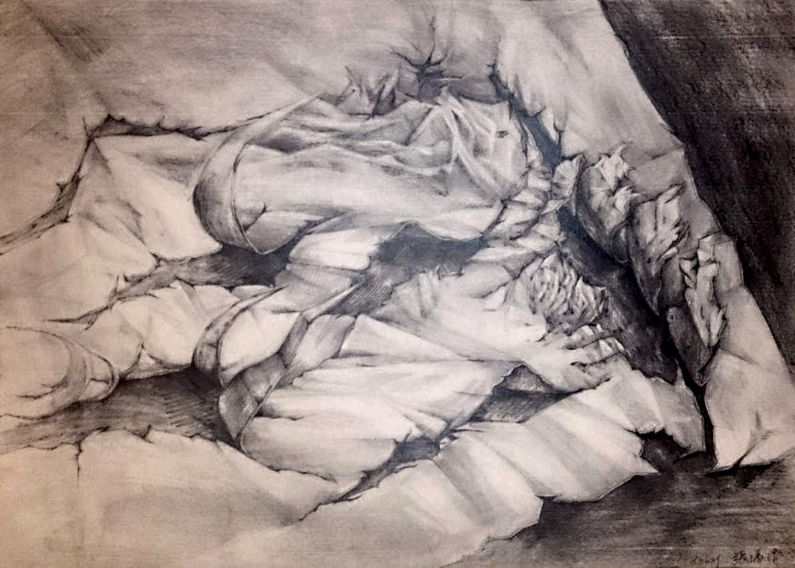
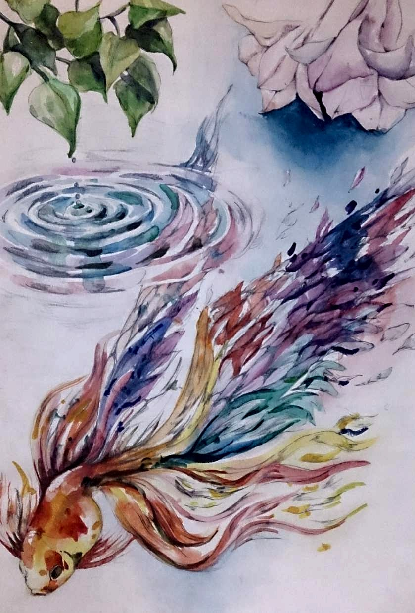
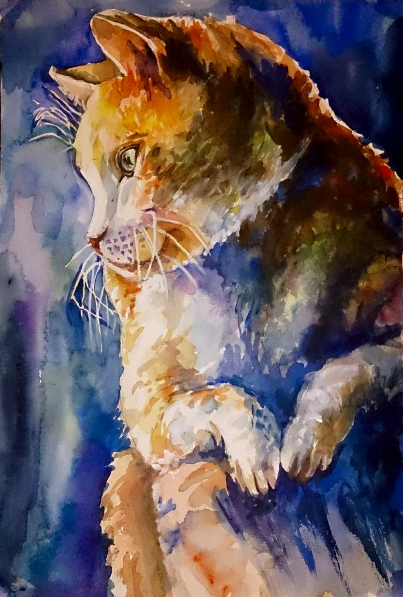

---
title:
  zh: 手繪作品
  en: Hand Drawings
summary:
  zh: 收錄炭筆與鉛筆素描、慕夏風格仿畫、水彩及插畫。
  en: Charcoal and pencil drawings, a study in the style of Mucha, watercolours and illustrations.
category: design
start: 2013
end: 2015
role:
  zh: 個人作品
  en: Personal work
status: archived
cover: ../../assets/projects/hand-drawings/still-life.jpg
coverAlt:
  zh: 炭筆靜物素描
  en: Charcoal still life
---

# zh
## 專案簡介

個人手繪作品，收錄炭筆與鉛筆素描、慕夏風格仿畫、水彩及插畫。

# en
## Overview

Personal drawings including charcoal and pencil studies, a study in the style of Mucha, watercolours and illustrations.

