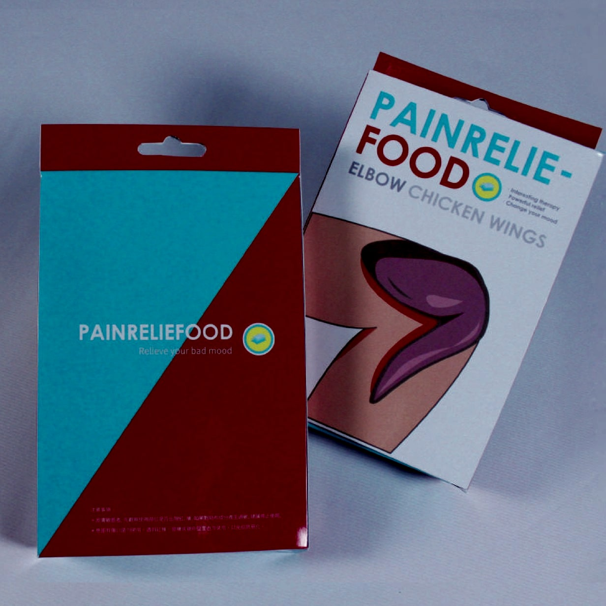

---
title:
  zh: PainRelieFood 食物痠痛貼
  en: PainRelieFood
summary:
  zh: 以食物烹煮時的變化為靈感，製作隨體溫變色的痠痛貼布與包裝。
  en: Thermochromic pain-relief patch and packaging prototypes inspired by food changing colour during cooking.
category: design
start: 2016
metrics:
  - label:
      zh: ASPaC 亞洲學生包裝設計競賽
      en: Asia Student Package Design Competition (ASPaC)
    value:
      zh: 台灣區金獎
      en: Gold Award
    note:
      zh: 2016 年 11 月
      en: Taiwan round, Nov. 2016
  - label:
      zh: ASPaC 國際決賽
      en: ASPaC international final
    value:
      zh: 優秀獎
      en: Excellence Award
    note:
      zh: 2017 年 1 月
      en: Jan. 2017
status: archived
cover: ../../assets/projects/painreliefood/packs.jpg
coverAlt:
  zh: PainRelieFood 痠痛貼的外盒與內包裝
  en: PainRelieFood outer boxes and inner packs
---

# zh
## 專案簡介

這款感溫變色痠痛貼布貼上後，會隨體溫升高改變顏色，呈現食物烹煮時的變化。每款以身體部位搭配食物命名，例如 Neck Salmon、Waist Steak、Knee Drumstick。

製作時使用粉狀感溫變色顏料，調配溫度變化前後的顏色，完成實體樣品並測試變色效果。

作品獲 ASPaC 亞洲學生包裝設計競賽台灣區金獎與國際決賽優秀獎。2017 年 1 月受日本主辦單位邀請，赴日參加為期兩週的包裝設計工作營與企業參訪，共有十國參與。

# en
## Overview

Thermochromic pain-relief patches that change colour as they warm with body heat, showing food being cooked. Each design pairs a body part with a food, such as Neck Salmon, Waist Steak and Knee Drumstick.

Made and tested physical samples using powdered thermochromic pigments, adjusting the colours before and after a temperature change.

The project won Gold in the Taiwan round of ASPaC and an Excellence Award at the international final. In January 2017, the Japanese organisers invited me to a two-week packaging design workshop and company visits in Japan, with participants from ten countries.

