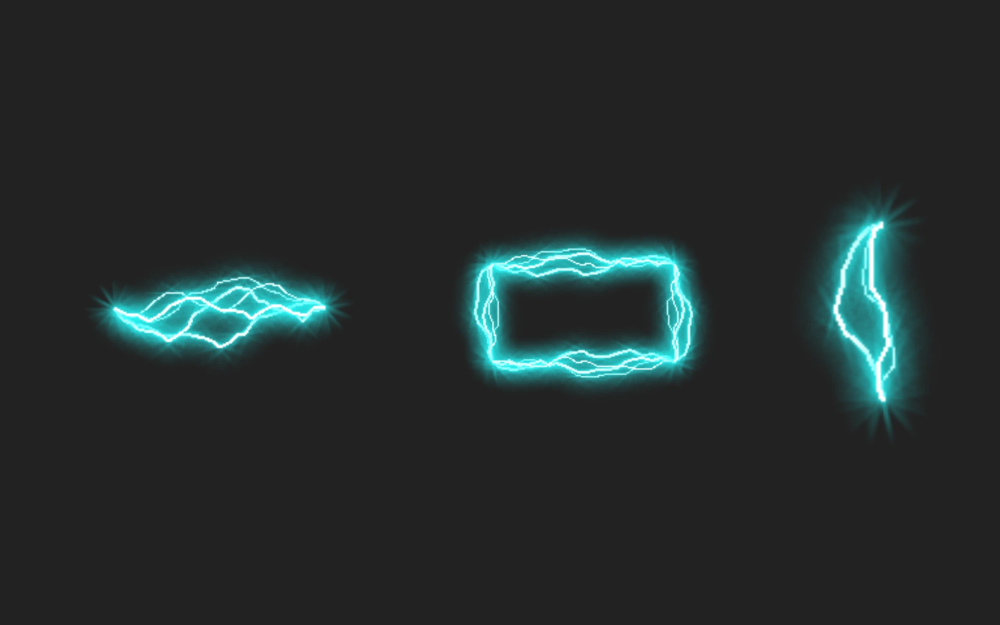

---
title:
  zh: PixiJS 閃電特效
  en: PixiJS Lightning
summary:
  zh: 結合遞迴路徑產生演算法與 GSAP 動畫，開發可重複使用的閃電特效函式庫。
  en: A reusable lightning-effect library built on a recursive path-generation algorithm and GSAP animations.
category: frontend
start: 2020
role:
  zh: 前端工程師（日新軟體）
  en: Front-end Engineer (Neutec Ltd.)
links:
  demo: https://codesandbox.io/p/sandbox/lightning-evolution-dynamic-r6oje
  github: https://github.com/yc-rainyu/PixiJS-lightning
status: live
cover: ../../assets/projects/pixijs-lightning/lightning-anim.webp
coverStill: ../../assets/projects/pixijs-lightning/lightning.webp
coverAlt:
  zh: 橫向閃電特效的動畫，閃電由左向右畫出後閃爍
  en: Animation of the horizontal lightning effect, drawing in from left to right and then flickering
---

# zh
## 專案簡介

在日新軟體任職期間，使用 JavaScript、PixiJS 與 GSAP 開發可重複使用的閃電特效函式庫，支援靜態與動態效果，後續獲公司多項產品採用。

- 設計路徑產生演算法，結合線性插值、正交偏移與遞迴細分，產生自然且不規則的閃電形狀。
- 使用 GSAP 時間軸製作 Flashing 與 Striking 兩種動畫，搭配發光濾鏡與逐漸收細的線寬，呈現閃爍與擊發效果。
- 將特效封裝成可重複使用的 API，提供路徑、角度與粗糙度等設定，並在測試頁面加入 dat.GUI 面板，即時調整參數。

# en
## Overview

Developed a reusable lightning-effect library at Neutec with JavaScript, PixiJS and GSAP, supporting static and animated effects. It was later adopted across the company’s products.

- Designed a path-generation algorithm combining linear interpolation, perpendicular offsets and recursive subdivision to create natural, irregular lightning shapes.
- Built Flashing and Striking animations with GSAP timelines, using glow filters and tapered line widths.
- Exposed a reusable API with controls for paths, angles and roughness, and added a dat.GUI panel to the test page for adjusting parameters in real time.

