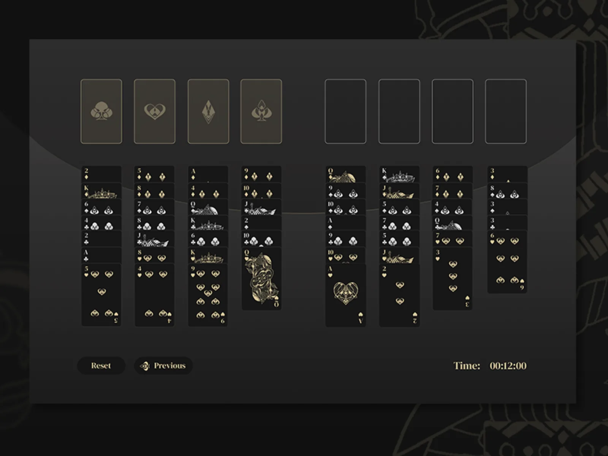
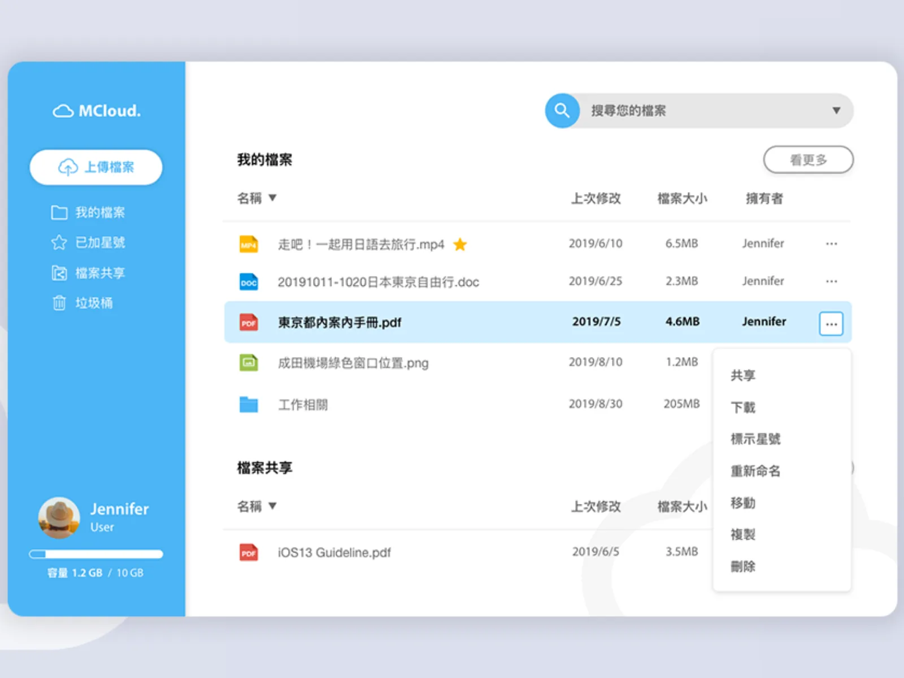
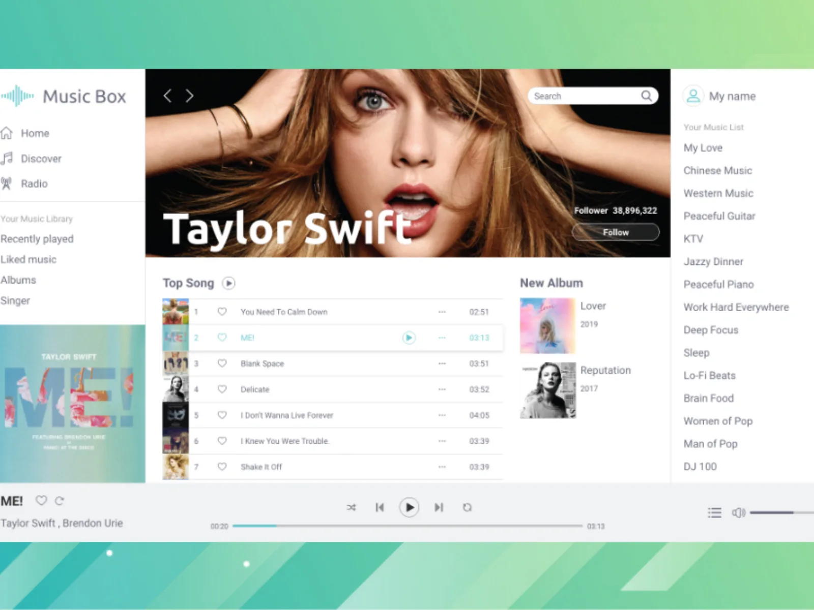

---
title:
  zh: The F2E 作品
  en: The F2E Projects
summary:
  zh: 準備轉職前端工程師時的練習作品，來自六角學院 The F2E 挑戰與自主練習。
  en: Front-end practice projects built for Hexschool’s The F2E Front-end Challenge and independent study.
category: frontend
start: 2019
role:
  zh: 個人練習作品
  en: Personal practice projects
cover: ../../assets/projects/the-f2e/freecell.webp
coverAlt:
  zh: 新接龍遊戲畫面
  en: Screenshot of the FreeCell game
status: live
---

# zh
## 專案簡介

2019 年準備轉職前端工程師時的個人練習作品，來自 The F2E 前端修煉精神時光屋與自主練習。The F2E 是為期九週的挑戰，每週在期限內完成並提交一個指定主題的網頁介面。

- [雲端硬碟](https://yc-rainyu.github.io/portfolio/storage/)是第 8 週的前端模擬作品，以 React 開發，可選取本機檔案與建立資料夾，並以巢狀 JSON 管理檔案名稱、大小等資料，存於 localStorage，檔案本身不會上傳至伺服器。
- [橫向 2D 挑戰遊戲](https://yc-rainyu.github.io/portfolio/game/)是第 5 週的限時挑戰作品，使用 Phaser 3 製作，包含碰撞、物理效果與隨機障礙物。
- [新接龍](https://yc-rainyu.github.io/portfolio/freecell/)是第 2 週作品，使用 JavaScript 與 jQuery 開發，支援拖放、發牌動畫與還原上一步。
- [MP3 Player](https://yc-rainyu.github.io/portfolio/media_player/) 是第 3 週作品，使用 jPlayer 與 jQuery 開發，支援播放控制、音量調整、重複播放、隨機播放與拖曳時間軸。

新接龍

雲端硬碟

MP3 Player

# en
## Overview

Personal projects built during the transition into front-end development in 2019, for The F2E Front-end Challenge and independent study. The challenge ran for nine weeks, with a new theme and a web interface to submit each week.

- [Cloud drive](https://yc-rainyu.github.io/portfolio/storage/) is a week 8 front-end simulation built with React. Users can select local files and create folders; names, sizes and other file metadata are managed as nested JSON in localStorage. File contents are not uploaded to a server.
- [Side-scrolling 2D game](https://yc-rainyu.github.io/portfolio/game/) is the week 5 timed challenge, built with Phaser 3, with collisions, physics and random obstacles.
- [FreeCell](https://yc-rainyu.github.io/portfolio/freecell/) is the week 2 project, built with JavaScript and jQuery, with drag and drop, a dealing animation and undo.
- [MP3 player](https://yc-rainyu.github.io/portfolio/media_player/) is the week 3 project, built with jPlayer and jQuery, with playback controls, volume, repeat and shuffle, and a draggable timeline.

FreeCell

Cloud drive

MP3 player

