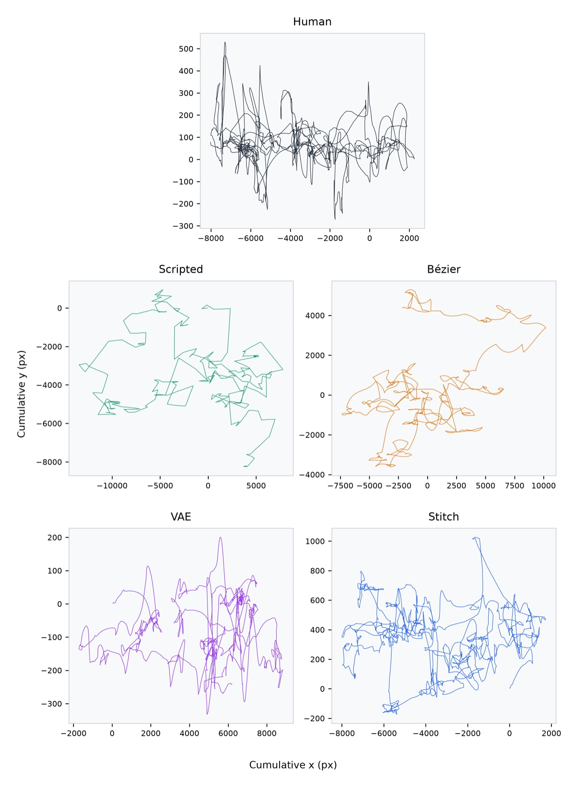

## 專案簡介

英國伯明罕大學的電腦科學碩士論文（2026），研究只用一款遊戲資料訓練的行為式反作弊偵測器，能否不經重新訓練就偵測另一款遊戲中的機器人，以處理新遊戲缺少作弊樣本的冷啟動問題。論文已投稿 ACM SAC 2027。

- 以 Python 將三種公開遊戲資料集（兩款 FPS、一款 MOBA，共 289 位玩家）的單位與紀錄方式統一為相同軌跡格式。包含把絕對游標座標轉成位移，以及把視線向量轉為 yaw／pitch 的角度變化，處理不同遊戲的座標與時間單位。
- 實作規則式、貝茲曲線、VAE 與真人片段拼接四種合成滑鼠軌跡產生器，以此訓練隨機森林偵測器，並採玩家不重疊的切分方式避免資料洩漏。
- 比較三組特徵集，門檻只以未標記的人類資料校準。最終 10 個尺度不變特徵在三個轉移方向上，對三種純合成攻擊皆達到 100% 偵測率（5% 誤報率，ROC-AUC ≥ 0.958）。真人拼接軌跡則能跨遊戲躲過運動學特徵偵測，因此提出分層防禦的必要性。
- 以 Claude 與 Cursor 進行規格驅動（SDD）開發，議定計畫與每週目標。生成內容均經人工確認，並完整記錄 AI 使用情形。

研究將跨遊戲失敗拆成分數分布改變、判斷方向反轉與特徵訊號消失，分別檢查門檻與特徵的影響。例如在 Red Eclipse → LoL 的 Bézier 攻擊中，原始特徵的 AUC 為 0.242，改用最終尺度不變特徵後達到 1.000。分類器仍採隨機森林，主要比較的是特徵設計如何影響轉移能力。

三個轉移方向為 Red Eclipse → CS:GO、CS:GO → Red Eclipse 與 Red Eclipse → LoL。零樣本轉移不重新訓練目標遊戲的偵測器，但仍使用目標遊戲的人類分數校準門檻，不需要目標遊戲的機器人樣本。真人片段拼接的負面結果也保留，作為運動學特徵偵測的限制。

