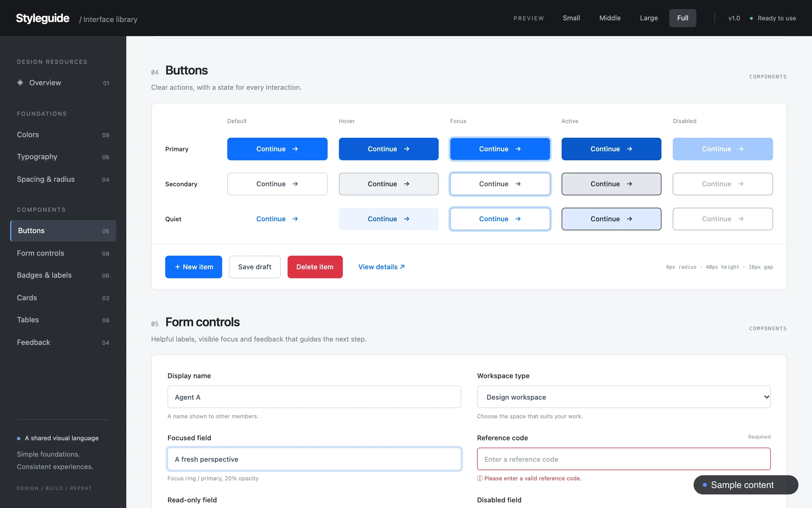
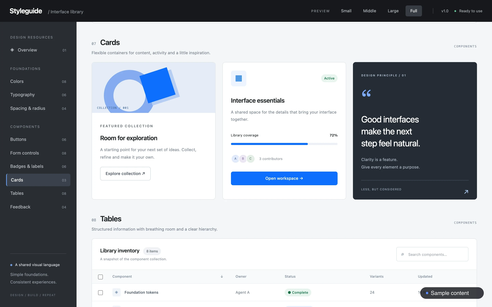

## 專案簡介

發現設計稿交付開發後常需來回 4 至 5 輪確認，因此主動開發設計師只需 HTML 與 CSS 就能使用的 UI 元件庫。以設定檔組織分類與元件，JavaScript 讀取 HTML 模板與專案 CSS，自動產生導覽目錄、元件預覽與程式碼範例，並支援一鍵複製 HTML。

4 位設計師與 3 位工程師在 2 至 3 項產品上使用，交付來回降至 1 至 2 輪，後續調整也直接以元件庫溝通。

畫面是放入示範內容的樣式指南模板。
