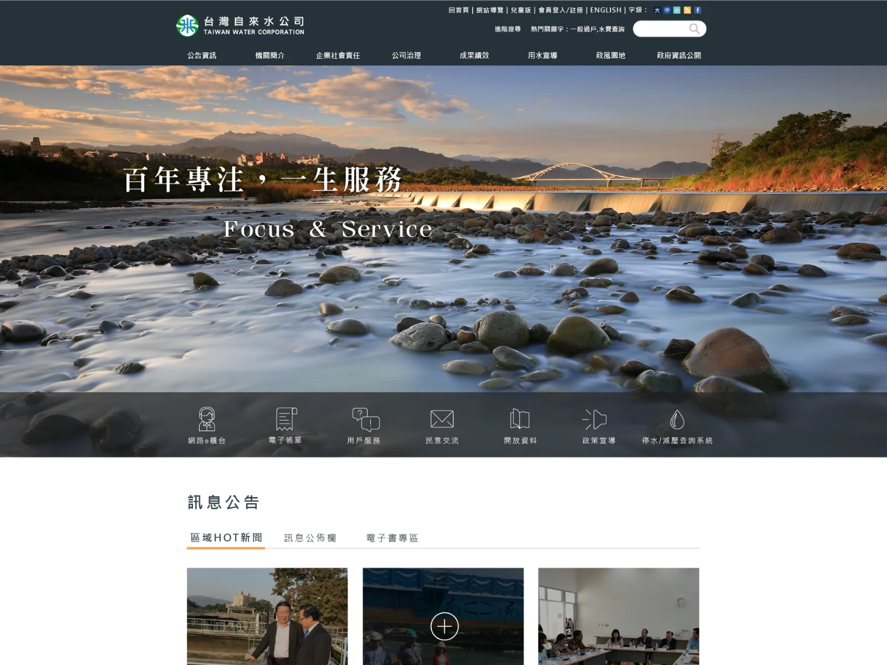
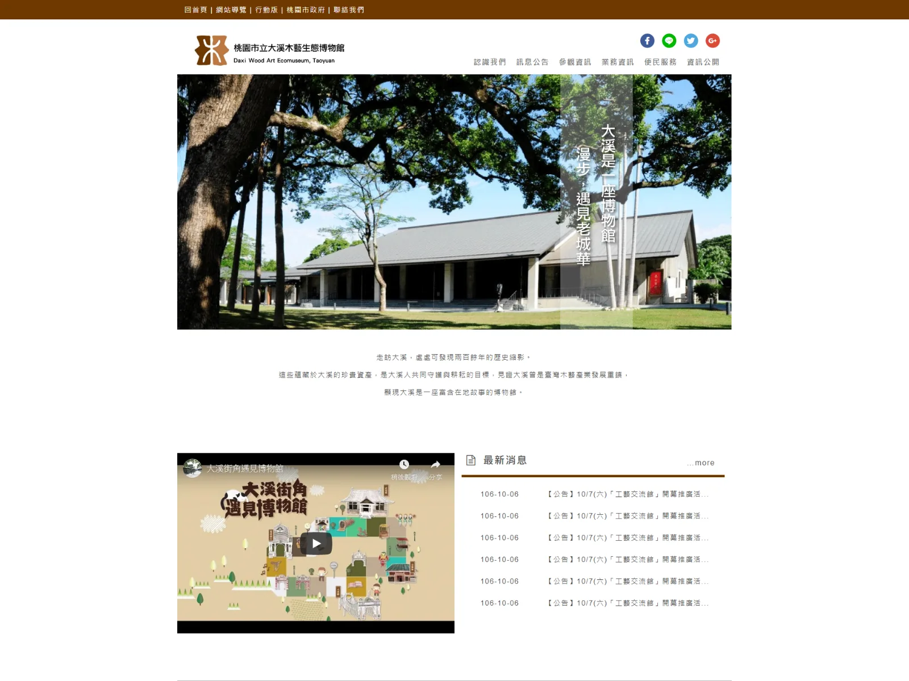
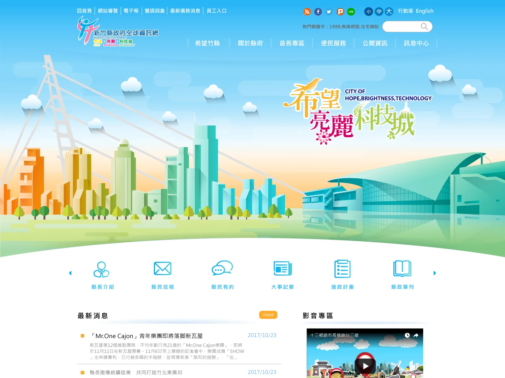
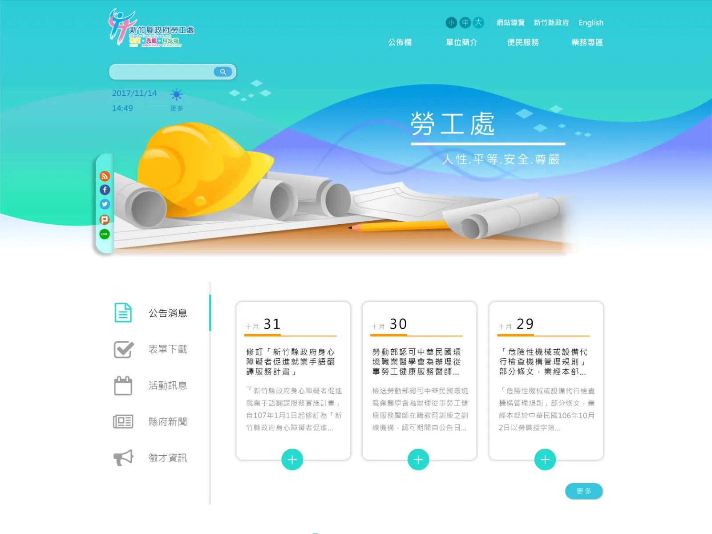
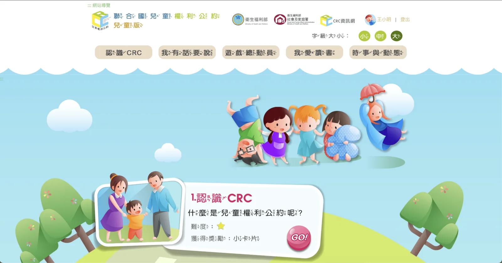

## 專案簡介

在桓基科技擔任前端設計師，負責政府機關網站的前端視覺設計與切版。設計並維護五個以上政府機關網站的 RWD 前端頁面，全數符合政府網站無障礙規範 2.0 的 AA 等級。

負責鍵盤導覽、焦點、圖片替代文字、表單標籤與文字對比等無障礙實作，並修正檢測發現的問題。檢測由公司執行，政府網站也會送交外部檢測，再依結果調整前端。

參與的網站包括下列項目。

- 台灣自來水公司 網站改版
- 衛生福利部疾病管制署 全球資訊網改版
- 衛生福利部社會及家庭署 兒童權利公約資訊系統
- 內政部 表單簽核系統
- 交通部公路總局 員工入口網暨即時訊息系統
- 勞動部 員工共用資訊系統平台擴充
- 桃園大溪木藝生態博物館 大溪學文化資源庫
- 新竹縣政府 全球資訊網
- 新竹縣政府 區處網站

台灣自來水公司 全球資訊網

桃園市立大溪木藝生態博物館

新竹縣政府 全球資訊網

新竹縣政府 區處網站

聯合國兒童權利公約 兒童版

