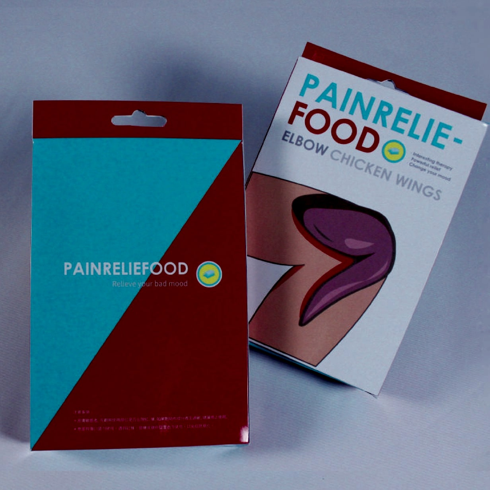

## 專案簡介

感溫變色的痠痛貼布，貼上後隨體溫升高而變色，呈現食物被烹煮的過程。款式以部位配食物命名，例如 Neck Salmon、Waist Steak、Knee Drumstick。

以感溫變色粉狀顏料調配變溫前後的顏色，製作實體樣品並測試變色效果。

作品獲 ASPaC 亞洲學生包裝設計競賽台灣區金獎與國際決賽優秀獎。2017 年 1 月受日本主辦方邀請，赴日參加兩週的包裝設計工作營與企業參訪，共十國參與。

