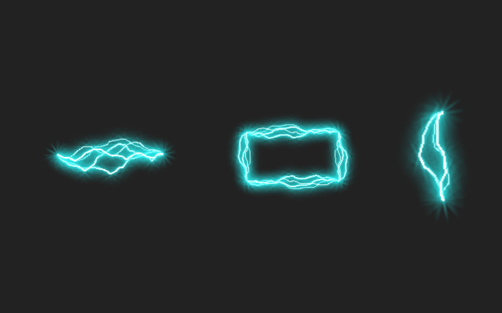

## 專案簡介

在日新軟體任職期間，以 JavaScript、PixiJS 與 GSAP 開發可重複使用的閃電特效函式庫，支援靜態與動態效果，後來被公司眾多產品採用。

- 設計路徑生成演算法，結合線性插值、正交偏移與遞迴細分，產生自然、不規則的閃電形狀。
- 以 GSAP timeline 製作 Flashing 與 Striking 兩種動畫，搭配發光濾鏡與漸細線寬呈現閃爍與擊發效果。
- 將效果包裝成可重複使用的 API，可調整路徑、角度與粗糙度，並在測試頁面以 dat.GUI 面板即時調整參數。

