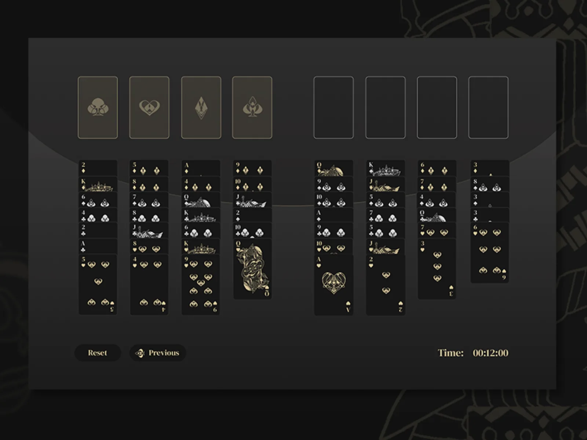
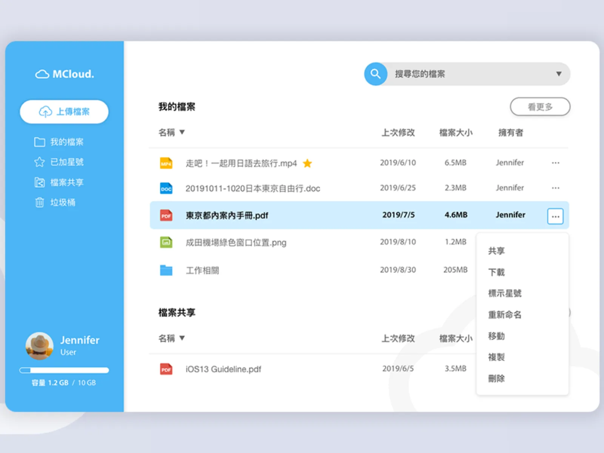
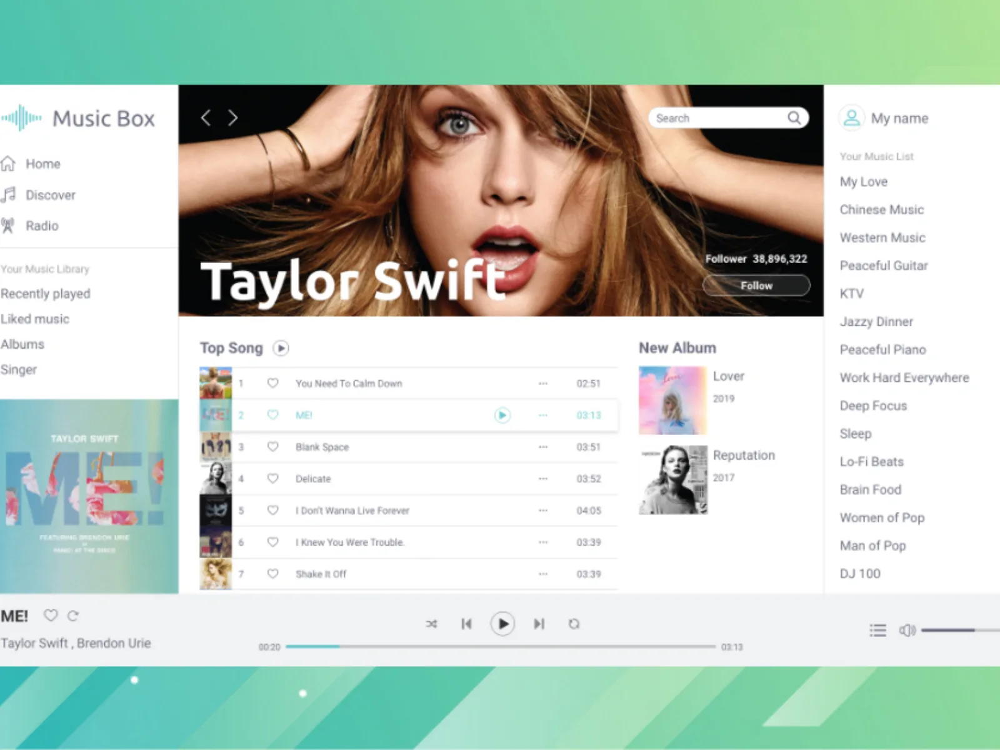

## 專案簡介

2019 年轉職前端期間的個人練習作品，來自 The F2E 前端修煉精神時光屋與自主練習。The F2E 是為期九週的挑戰，每週依新主題完成一個網頁介面，並在當週期限內提交。

- [雲端硬碟](https://yc-rainyu.github.io/portfolio/storage/)是第 8 週的前端模擬作品，使用 React 選取本機檔案並建立資料夾，以巢狀 JSON 管理檔案名稱、大小等資料，存於 LocalStorage；不會將檔案本體上傳至伺服器。
- [橫向 2D 挑戰遊戲](https://yc-rainyu.github.io/portfolio/game/)是第 5 週的限時挑戰作品，使用 Phaser 3，包含碰撞與物理、隨機障礙物。
- [新接龍](https://yc-rainyu.github.io/portfolio/freecell/)是第 2 週作品，使用 JavaScript 與 jQuery，拖放、發牌動畫、還原上一步。
- [MP3 Player](https://yc-rainyu.github.io/portfolio/media_player/)是第 3 週作品，使用 jPlayer 與 jQuery，包含播放控制、音量、重複與隨機、拖動時間軸。

新接龍

雲端硬碟

MP3 Player

